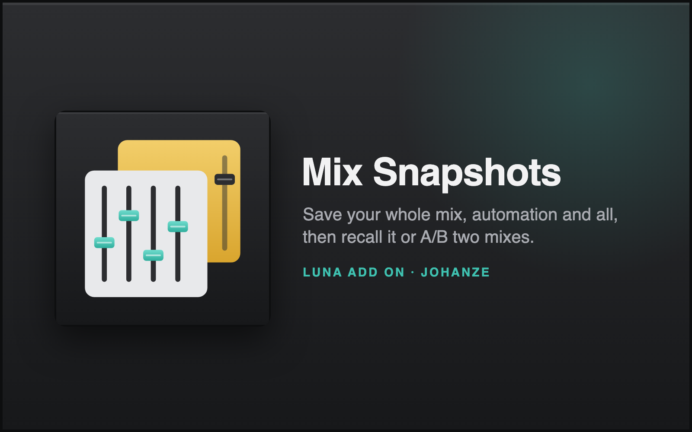

# Mix Snapshots for LUNA



Save your whole mix as a snapshot (every fader, pan, mute, send and plug-in setting, with
their automation), then recall it later or flip between two mixes. "My mix" against the
client's, a mix per cutdown, before and after a change: each recall is one undo step.

Needs LUNA 3.1.2 or later, on macOS.

## Install

Download `mix-snapshots.lunaaddon` from the
[latest release](https://github.com/johanze-ops/mix-snapshots/releases/latest) and
double-click it, and LUNA installs it. Then open **Add Ons > Windows > Mix Snapshots**. It
opens in a small window that floats over LUNA, so it stays visible on the Mixer too.

## Use

- **Save:** type a name (or leave it for "Snapshot 1"…) and press **Save** or Return.
- **Recall:** press **Recall** on a snapshot. It changes only what differs from the mix as it
  is now, as one undo step, so **Undo** in LUNA takes it back.
- **A/B:** click the **A** and **B** chips on two snapshots, then click A or B, press the
  **A** / **B** keys, or **Tab** (or ⇄) to flip. Flipping replaces its own previous step in the
  undo list instead of adding one each time, unless you've changed something in between.
- **Choose what to recall** with the ticks: Levels, Pans, Mutes, Sends, Plug-ins, and
  **+ their automation**. Ticked, the automation of what you recall comes back too, along
  with the tracks' Read/Off modes. Unticked, your current automation is left as it is.
  Leave everything ticked to get the mix back exactly.
- **↻** replaces a snapshot with the mix as it is now, **×** deletes it (both ask "Sure?"),
  and double-clicking a name renames it.

## What's in a snapshot

For every track, aux bus and the master:

- fader, pan, mute, and each send's level and mute;
- every parameter of every plug-in, including the channel strip and tape extensions, and
  whether each plug-in is in;
- the automation of all of those, and the track's automation mode.

Not included: solo, send routing (which bus a send goes to), adding or removing plug-ins, and
clip gain. If a track was deleted or a plug-in swapped since the snapshot was saved, recall
says so and does the rest.

A control with automation, on a track that reads it, takes its level from its automation, so
recall brings back its automation, not a single value.

## Good to know

- Snapshots are saved in the session, so they go wherever the session goes. Saving one isn't
  an undo step, so Undo never deletes a snapshot.
- Plug-in settings are saved as parameter values. A plug-in that keeps something outside its
  parameters (a loaded sample or impulse response, say) gets its parameters back, not that.

## Develop

```sh
npm install
npm test            # runs against the SDK's mock engine, no LUNA needed
npx ua-builder serve
npx ua-builder install
node tests/live/desk.mjs   # against a running LUNA, in a session called snaptest only
```

`logic.js` captures, compares and recalls mixes (no DOM, tested); `main.js` is the window.

Built with UA's [LUNA Builder SDK](https://github.com/uaudio-labs/luna-builder-sdk).
`vendor/luna.global.js` is UA's SDK under the Apache License 2.0 (see
`vendor/LICENSE-luna-builder-sdk` and `vendor/NOTICE-luna-builder-sdk`); everything else is
MIT, by JOHANZE.
